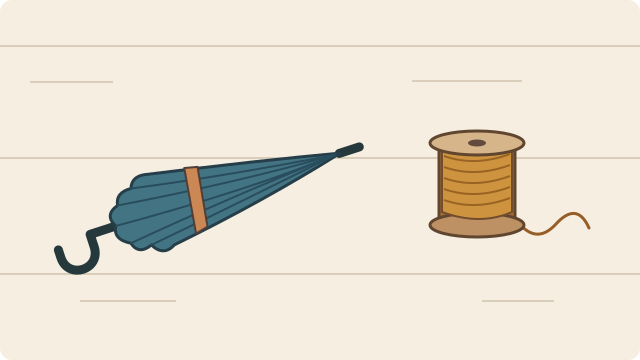

# Storytelling

[繁體中文](README.zh-TW.md) · [Try the workshop](#try-one-source-set-in-two-media) · [Install](#start-with-the-skill) · [Templates](skills/storytelling/references/multimodal-templates.md) · [Contributing](https://github.com/bynanci/storytelling/blob/main/CONTRIBUTING.md) · [CI](https://github.com/bynanci/storytelling/actions/workflows/ci.yml)

Storytelling helps authors turn source material into stories for a specific audience. Start with the [Agent Skill](skills/storytelling/SKILL.md), a set of instructions an AI assistant can load. You can also follow the instructions yourself. Use notes, images, recordings, descriptions, or transcripts to draft a spoken account, scene, illustration brief, or script.

<a name="為什麼需要-storytelling"></a>

## Why Storytelling?

Two neighbors repair a gate. A newsletter can start with their cooperation.

> One held the gate while the other tightened the hinge.

A speaker can start with the result.

> This time the gate cleared the ground.

Both openings describe the same event. The author chooses what the audience learns first. If the notes change who tightened the screw, which lines and drawings need a second look? If the author adds an imaginary red umbrella to one illustration, that choice belongs to that version. A single anecdote may need only a paragraph. Multiple versions can benefit from a record of these choices. [Author exercise](https://github.com/bynanci/storytelling/blob/main/docs/narrative/N-01-AUTHOR-STUDY.md) · [Research and product decisions](https://github.com/bynanci/storytelling/blob/main/docs/WHY_STORYTELLING.md)

<a name="把同一份素材做成廣播與海報"></a>

## Try one source set in two media

The fictional workshop supplies an [event notice and source descriptions](skills/storytelling/references/workshop-demo.md), [workbench diagram (SVG)](skills/storytelling/assets/umbrella-workshop/bench.svg) and [two-tap sound cue (WAV)](skills/storytelling/assets/umbrella-workshop/taps.wav). Open the files in an assistant that can read them. If it cannot read a file, supply its description.



```text
Make an invitation for residents visiting our umbrella workshop for the first time.
Notice: the session is on Saturday. Bring one umbrella.
Diagram: a folded umbrella on the left, a spool of thread on the right.
Audio: two synthesized taps, no speech.
Write a radio cue and two poster briefs, one Swiss-style grid and one cut-paper
collage. Show which details come from the sources and which are design choices.
```

| Deliverable | Example of a usable draft |
| --- | --- |
| Radio cue | **SOUND** Play the two taps, then leave a beat. **VOICE** “One umbrella. Bring yours to Saturday’s repair workshop.” The invitation comes from the notice. The taps are a production cue. |
| Poster A · Swiss-style grid | Keep the diagram’s umbrella and spool in their original order. Set “Saturday” and “Bring one umbrella” on the same left edge below them. Alignment directs the eye to the invitation. |
| Poster B · cut-paper collage | Cut a yellow paper arc and pull a loose thread across it toward the word “Saturday.” Label the open shape and yellow paper as choices for this illustration. |

A narrator can record the cue and an illustrator can sketch either brief. The Skill supplies scripts and directions. Finished images and audio require a capable host or a separate production tool. [Full mixed-media template](skills/storytelling/references/multimodal-templates.md#mixed)

<a name="依情境選樣板與流派"></a>

## Choose a template and an approach

Each template includes a brief you can copy, two ways to treat the material and a check for the result. Try the [audience readings and revision exercises](https://github.com/bynanci/storytelling/blob/main/examples/README.md) with a reader and a handoff editor.

| Situation | Two approaches to try | What you take away |
| --- | --- | --- |
| [Screenplay](skills/storytelling/references/multimodal-templates.md#screenplay) · A character returns a borrowed object | Social realism follows the exchange in real time. A flashback reveals why returning it matters. | A scene with playable action, dialogue and a reveal. |
| [Illustration](skills/storytelling/references/multimodal-templates.md#illustration) · Turn an event notice into a poster | Swiss-style typography gives the facts a reading order. Cut-paper collage uses shape to draw the eye. | A composition brief with subject, focal point, layout and text placement. |
| [Business copy](skills/storytelling/references/multimodal-templates.md#copy) · Invite someone to try a service | AIDA leads from attention to action. Problem–solution copy opens with the reader’s difficulty. | A headline, body, call to action and claims to check. |
| [Brainstorm](skills/storytelling/references/multimodal-templates.md#brainstorm) · A team needs three event concepts | SCAMPER varies an existing idea. Reverse brainstorming asks how to make the experience worse, then reverses the answer. | Distinct options, a selection criterion and a small test. |
| [Everyday story](skills/storytelling/references/multimodal-templates.md#everyday) · Tell a friend what happened | Open inside the scene to build curiosity, or give the outcome first when the listener needs context. | A tellable account that keeps observed events separate from interpretation. |
| [Audio](skills/storytelling/references/multimodal-templates.md#audio) · Open a podcast with a field recording | A sound diary lets the listener hear the space first. A narrated essay opens with a point of view. | A script with voice, sound cues, pauses and source notes. |
| [Video](skills/storytelling/references/multimodal-templates.md#video) · Cut a short sequence from supplied clips | Continuity editing follows the action. Associative montage connects images by shape or idea. | A shot plan that maps beats to clips and identifies missing coverage. |

## Cross-media Rust support

The templates work with an agent or as plain Markdown. The optional Rust command-line interface (CLI) checks structured documents. It can order shot windows or print an oral outline and illustration briefs from one narrative document. Each draft retains its declared source IDs and origins. The CLI can also show which drafts refer directly to a changed source. These commands read structured data. They do not read or create media. [CLI guide](https://github.com/bynanci/storytelling/blob/main/docs/CLI_GUIDE.md) · [Narrative example](https://github.com/bynanci/storytelling/blob/main/docs/validation/n03-narrative-cli.md) · [Task list](https://github.com/bynanci/storytelling/blob/main/TASKS.md#multimodal-rust-backlog) · [Roadmap](https://github.com/bynanci/storytelling/blob/main/ROADMAP.md)

<a name="從-skill-開始"></a>

## Start with the skill

<a name="安裝到-ai-助理"></a>

### Install for an agent

Use Node.js 22.20 or later. In your project directory, run these commands. To install for one agent, specify only its name. To select agents interactively, omit `-a codex claude-code`.

```sh
npx skills add bynanci/storytelling --skill storytelling -a codex claude-code
npx skills list
```

<a name="使用-npm-鎖定版本"></a>

### Install as an npm dependency

Use npm to record the skill revision in your project lockfile. In a project with a `package.json`, install the package from GitHub. The second command copies the skill into the agent directories.

```sh
npm install -D github:bynanci/storytelling
npx skills add ./node_modules/@bynanci/storytelling/skills/storytelling --skill storytelling -a codex claude-code --copy -y
```

Commit `package.json` and `package-lock.json`. Rerun the second command after changing the dependency revision. The npm package contains the skill instructions, references and Python helpers. Build the optional Rust CLI separately using the source quick start below.

<a name="開始使用"></a>

### Use the installed skill

The table gives the project locations and invocation syntax. For a manual install, copy the complete [skill folder](skills/storytelling), including its license, to the listed destination.

| Where you work | How to start |
| --- | --- |
| Codex in a project | Place the folder at `.agents/skills/storytelling/` in the project. Invoke `$storytelling`. |
| Claude Code in a local project | Place the same folder at `.claude/skills/storytelling/` in the project. Invoke `/storytelling`. |
| Another Agent Skills client | Use the client's documented skill loader. Discovery paths, invocation syntax and available tools belong to the client. |
| Plain Markdown | Open [SKILL.md](skills/storytelling/SKILL.md) and the references it links. A writer or team can follow the workflow by hand. |
| A script, CI job or application | Use the [standalone CLI](#quick-start) with structured input. Read the output format and exit codes for each command. |

For personal installs, other clients and verification status, see the [platform guide](https://github.com/bynanci/storytelling/blob/main/docs/PLATFORMS.md).

<a name="核對素材與修改草稿"></a>

## Working with sources and revisions

Research-backed guidance is available as [14 editorial rules and six workflows](docs/research/README.md), with primary sources, limits and links to existing tasks. Use the relevant workflow without adding a new installation.

- **Review a draft.** Compare the draft with the author’s notes. Mark details the author or assistant inferred or invented. Ask for changes to the affected drafts. [Worked examples](skills/storytelling/references/examples.md)
- **Coordinate complex work.** Use the graph-loop playbook for dependencies, independent branches, review and bounded retries. The skill includes optional Python helpers for planning a dependency graph and checking a recorded execution order. [Playbook](skills/storytelling/references/graph-loops.md)
- **Find supporting material.** For a question about several documents, look for an existing Graphify index. Use it to locate relevant passages. Check each passage against its source. [Graphify guide](skills/storytelling/references/graphify-tools.md)

<a name="快速開始"></a>

## Quick start

### Optional Rust CLI

The development version is `0.1.0-dev.0`. Build it from source with Rust 1.89.0. These examples run without an AI subscription, model API key, or video editor. Install [rustup](https://rustup.rs/). Then run these commands in a terminal.

```sh
git clone https://github.com/bynanci/storytelling.git
cd storytelling
cargo run --quiet --locked -p storytelling-cli -- render-narrative tests/fixtures/narrative-v1/n03-author-reviewed-v1.json
cargo run --locked -p storytelling-cli -- validate examples/minimal-plan.json
cargo run --locked -p storytelling-cli -- plan-story tests/fixtures/planner-v1/valid.json
```

`render-narrative` prints one spoken outline and two illustration briefs for the supplied example. It preserves the source IDs and revisions in the text.

`validate` reports `ok: true` for one asset and two shots. `plan-story` prints JSON with `detail` before `opening`, preserving the author's explicit order even though `opening` has a higher score. To integrate your own application, start with these input shapes and the [CLI contracts](https://github.com/bynanci/storytelling/blob/main/docs/CONTRACTS.md). [Planner input](https://github.com/bynanci/storytelling/blob/main/tests/fixtures/planner-v1/valid.json) · [CLI guide](https://github.com/bynanci/storytelling/blob/main/docs/CLI_GUIDE.md)

<a name="查出修改影響哪些草稿"></a>

### Trace a source correction

`NarrativeRevisionLedgerV1` records events after a base narrative document. Inspect its source revisions, variant snapshots and declared author decisions. Then query the impact of each source-change event.

```sh
cargo run --quiet --locked -p storytelling-cli -- track-narrative-revisions tests/fixtures/narrative-v1/n04-revision-history-v1.json
cargo run --quiet --locked -p storytelling-cli -- query-narrative-impact tests/fixtures/narrative-v1/n04-revision-history-v1.json shared-observation-change
cargo run --quiet --locked -p storytelling-cli -- query-narrative-impact tests/fixtures/narrative-v1/n04-revision-history-v1.json b-only-detail-change
```

The shared correction affects the oral outline and both illustration briefs. The second change affects only `illustration-close`. The query follows each variant’s direct source references. Authors check indirect references separately. A declared author decision does not authenticate the person who entered it. [Revision ledger format](https://github.com/bynanci/storytelling/blob/main/docs/narrative/NARRATIVE_REVISION_LEDGER_V1.md) · [Expected outputs and validation](https://github.com/bynanci/storytelling/blob/main/docs/validation/n04-narrative-revisions.md)

### Check a narrative order rule (N-08)

The same workshop facts support two openings: one states the event before the taps; the imagery version places two synthetic taps first. A separate `NarrativeStyleProfileV1` binds the order rules to a document revision and explicit spoken-beat IDs.

```sh
cargo run --quiet --locked -p storytelling-cli -- check-narrative-style tests/fixtures/narrative-v1/n08-umbrella-openings-v1.json tests/fixtures/narrative-v1/n08-style-profile-v1.json
```

The command checks declared beat order and returns JSON. It does not judge aesthetics or establish author approval. The imagery metaphor is a creative proposal based on S3, not a claim about the sound's cause. The label-free reader trial remains pending. [N-08 profile and validation record](https://github.com/bynanci/storytelling/blob/main/docs/validation/n08-style-profile.md)

### Build a recording cue sheet (N-09)

The cue sheet binds a spoken line, a pause and the supplied two-tap WAV to the umbrella invitation. It keeps the spoken line's length unknown until recording, labels the pause estimate, and reports the WAV's declared duration. It checks exclusive-track overlaps without reading or mixing audio.

```sh
cargo run --quiet --locked -p storytelling-cli -- render-cue-sheet tests/fixtures/narrative-v1/n09-umbrella-source-v1.json tests/fixtures/narrative-v1/n09-cue-sheet-v1.json
```

The CLI reads a separate closed `NarrativeCueSheetV1`; `NarrativeDocumentV1` remains unchanged. The rendered cue sheet is a production aid, not a recording. [Profile](docs/narrative/NARRATIVE_CUE_SHEET_V1.md) · [N-09 replay evidence](docs/validation/n09-cue-sheet.md)

<a name="影片整合"></a>

### Video integrations

<details>
<summary>Video commands, input limits and editor compatibility</summary>

| Input | Commands | Result |
| --- | --- | --- |
| A plan, brief, or request with explicit shot windows | `validate`, `audit-brief`, `plan-story` | Check declared references and constraints, or propose a shot order. |
| Local bytes and an expected SHA-256 digest | `verify-source` | Compare up to 16 MiB from a file or standard input with the expected digest. |
| A composition snapshot in the supported input format | See the [snapshot import and export instructions](https://github.com/bynanci/storytelling/blob/main/docs/CLI_GUIDE.md). | Convert one contiguous picture track into a plan or OpenTimelineIO (OTIO). |
| A snapshot and its review context | `prepare-review`, `check-review` | Save a review record, then compare that record with current inputs. |
| A saved proposal, matching snapshot and review context | `prepare-story-review`, `export-story-otio`, `check-story-review` | Export selected cuts as OTIO. Compare a saved review bundle with the current inputs to detect changes. |

The snapshot adapter accepts stills and video cuts on one contiguous picture track. The [input profile](https://github.com/bynanci/storytelling/blob/main/docs/migration/FINITE_V1.md) defines the required structure and the cases the adapter rejects. Video export requires an explicit picture-only choice. A FilmCraft v0.18.0 test on Linux at 25 fps covered save/reopen, OTIO reimport and a 45-frame CPU preview. In a separate test, the editor applied an import but did not return a reply. The test read the project state to establish the result. The roadmap lists editor writes for production use. Audio handoff and full-resolution output await verification. [FilmCraft test record](https://github.com/bynanci/storytelling/blob/main/docs/migration/records/M1-03.md) · [Recovery test](https://github.com/bynanci/storytelling/blob/main/docs/validation/m3-03-filmcraft-execution.md) · [Review contract](https://github.com/bynanci/storytelling/blob/main/docs/migration/PLANNER_OTIO_REVIEW_V1.md)

</details>

<a name="架構與參與開發"></a>

## Architecture and contributions

The portable skill is in `skills/storytelling/`. The Rust workspace contains four crates.

| Crate | Responsibility |
| --- | --- |
| `storytelling-core` | Define data types and represent exact time. |
| `storytelling-engine` | Check inputs and compute plans in memory. |
| `storytelling-cli` | Read input and write command results. |
| `storytelling-journal` | Keep a durable record of operations in SQLite. |

See the [architecture guide](https://github.com/bynanci/storytelling/blob/main/docs/ARCHITECTURE.md)

Contributions from other domains and agent clients are welcome. For a new workflow, include a synthetic request and the expected output. Explain how a contributor can check the result. For a compatibility report, include the client, version, installation location and what you observed. Consult the [contribution guide](https://github.com/bynanci/storytelling/blob/main/CONTRIBUTING.md), [open tasks](https://github.com/bynanci/storytelling/blob/main/TASKS.md), [requirements](https://github.com/bynanci/storytelling/blob/main/docs/REQUIREMENTS.md) and [development process](https://github.com/bynanci/storytelling/blob/main/docs/SDLC.md). [Report an issue](https://github.com/bynanci/storytelling/issues/new/choose) · [Security policy](https://github.com/bynanci/storytelling/blob/main/SECURITY.md)

<a name="授權"></a>

## License

Original Storytelling code, documentation, and the portable skill use the MIT License. Some components use Apache License 2.0. The source record lists these components and their notices. [Project license](LICENSE) · [Skill license](skills/storytelling/LICENSE) · [Apache License 2.0](https://github.com/bynanci/storytelling/blob/main/LICENSES/Apache-2.0.txt) · [Licenses by file](https://github.com/bynanci/storytelling/blob/main/PROVENANCE.md)
