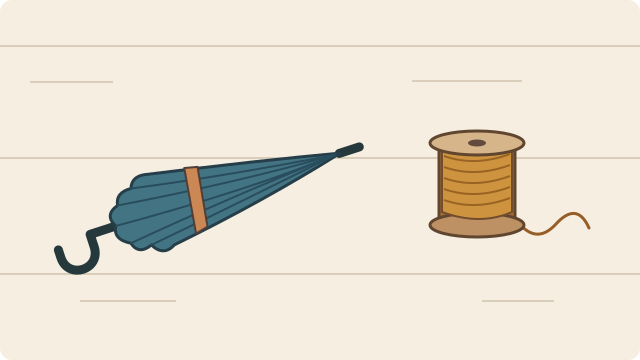

# Storytelling

[English](README.md) · [多模態樣板集](skills/storytelling/references/multimodal-templates.md) · [跨平台安裝](https://github.com/bynanci/storytelling/blob/main/docs/PLATFORMS.md) · [貢獻指南](CONTRIBUTING.md) · [CI](https://github.com/bynanci/storytelling/actions/workflows/ci.yml)

Storytelling 是給編劇、插畫師、剪輯師，以及日常想把事情說清楚的人使用的開源 [Agent Skill](skills/storytelling/SKILL.md)。你可以給它筆記、宿主能讀取的圖片或錄音，也可以提供畫面描述或逐字稿，指定受眾、作品形式與想嘗試的敘事手法。相同材料可以寫成一場戲、一份構圖提案、一段廣播稿，或一則邀請文案。

## 把同一份素材做成廣播與海報

這是一個虛構工作坊，附上可開啟的[活動公告與聽寫紀錄](skills/storytelling/references/workshop-demo.md)、[工作桌示意圖（SVG）](skills/storytelling/assets/umbrella-workshop/bench.svg)和[兩聲敲擊音檔（WAV）](skills/storytelling/assets/umbrella-workshop/taps.wav)。可以交給能讀取這些格式的 Agent，也可以直接貼下列素材描述。



```text
請邀請沒來過的居民參加修傘工作坊。素材有三份。
公告寫著週六舉辦，請每人帶一把傘。
工作桌示意圖左邊是一把收好的傘，右邊是一捲線。
音檔是合成的兩聲敲擊，沒有人聲。
請寫一段廣播開場，再給兩款海報構圖，一款用瑞士網格，一款用剪紙拼貼。
標出哪些細節來自素材，哪些是你的創作提議。
```

| 交付物 | 可以拿去試作的草稿 |
| --- | --- |
| 廣播開場 | **音效**　播出兩聲敲擊，停一拍。**口白**　「帶一把傘。這個週六，我們在修傘工作坊見。」週六與帶傘的邀請取自公告，敲擊聲是製作用的音效。 |
| 海報 A · 瑞士網格 | 保留示意圖「左傘、右線捲」的順序，在圖下將「週六」和「帶一把傘」靠同一條左邊線排齊，用對齊引導讀者讀完邀請。 |
| 海報 B · 剪紙拼貼 | 用黃紙剪出張開的傘面弧形，讓一段線頭穿過弧形，指向「週六」兩字。張開的傘與黃紙用色只屬於這一版的創作提議。 |

配音員可以照稿試錄，插畫師則能任選一版起稿。Skill 交付文字與製作指引。要產出完稿圖像或音訊檔，需交給具備對應能力的宿主工具或製作軟體。[完整跨模態樣板](skills/storytelling/references/multimodal-templates.md#mixed)

## 依情境選樣板與流派

每個樣板都有可複製的需求、兩種處理方式，以及檢查成品的方法。

| 使用情境 | 兩種可比較的做法 | 拿到什麼 |
| --- | --- | --- |
| [編劇](skills/storytelling/references/multimodal-templates.md#screenplay) · 角色歸還一件借來的東西 | 社會寫實按事件順序觀察兩人的動作。倒敘可以等物件交回後，才揭開它的重要性。 | 有可表演動作、對白與揭露點的一場戲。 |
| [插畫構思](skills/storytelling/references/multimodal-templates.md#illustration) · 把活動通知畫成海報 | 瑞士網格用字級與對齊安排閱讀順序。剪紙拼貼靠形狀引導視線。 | 主體、視覺焦點、構圖與文字位置。 |
| [商業文案](skills/storytelling/references/multimodal-templates.md#copy) · 邀請讀者試用一項服務 | AIDA 從引起注意寫到行動。問題解決型先寫讀者正在經歷的困難。 | 標題、內文、行動呼籲與待查證主張。 |
| [腦力激盪](skills/storytelling/references/multimodal-templates.md#brainstorm) · 團隊要想三個活動方案 | SCAMPER 用替換、合併等方式改造舊點子。逆向思考先列出把體驗搞砸的方法，再反推解法。 | 不同方向的選項、篩選標準與小型試驗。 |
| [日常敘事](skills/storytelling/references/multimodal-templates.md#everyday) · 跟朋友說剛才發生的事 | 從現場起講，讓聽者慢慢拼出經過。先講結果，適合需要快速掌握重點的聽者。 | 一段講得出口，也分得清所見與感受的敘述。 |
| [聲音敘事](skills/storytelling/references/multimodal-templates.md#audio) · 用現場錄音開一集 Podcast | 聲音日記先讓人聽見空間。口述隨筆先立敘事觀點，再引入聲音。 | 標出旁白、音效、停頓與聲音來源的腳本。 |
| [影片規劃](skills/storytelling/references/multimodal-templates.md#video) · 從幾段素材剪出短片 | 連續剪輯靠動作接鏡。聯想蒙太奇靠形狀或概念把兩個鏡頭接起來。 | 節拍、對應素材與缺鏡清單。 |

## Rust 對跨模態創作的支援進度

上述樣板已可交給 Agent 起草，也可以直接閱讀 Markdown 使用。現有 Rust CLI 能在既有規格內驗證影片提案與規劃鏡頭。跨模態來源對照、各形式的結構驗證與修訂影響追蹤，需要後續的 Rust 資料契約。各項缺口、開發順序與驗收條件已列入[多模態 Rust 任務與 Issues](TASKS.md#multimodal-rust-backlog)及[開發路線圖](ROADMAP.md)。

## 從 Skill 開始

### 安裝到 Agent

在要使用 Storytelling 的專案根目錄，以 Node.js 22.20 或更新版本執行下列命令。只用一個 Agent 時，保留對應的名稱即可。省略 `-a codex claude-code` 可在安裝時選擇。

```sh
npx skills add bynanci/storytelling --skill storytelling -a codex claude-code
npx skills list
```

### 作為 npm 開發依賴安裝

想用 npm 鎖定團隊使用的 Skill 版本，可在有 `package.json` 的專案中選擇這條路徑。第一行從 GitHub 安裝套件，第二行將套件內的 Skill 複製到 Agent 可讀取的位置。

```sh
npm install -D github:bynanci/storytelling
npx skills add ./node_modules/@bynanci/storytelling/skills/storytelling --skill storytelling -a codex claude-code --copy -y
```

將 `package.json` 和 `package-lock.json` 一併提交。日後變更依賴版本，請重跑第二行以更新 Agent 使用的副本。npm 套件內含操作指引、參考文件與 Python 輔助腳本。選用的 Rust CLI 可依本文的原始碼快速開始步驟另行建置。

### 叫用已安裝的 Skill

下表列出各專案的安裝位置與叫用方式。手動安裝時，請將含授權檔的完整 [Skill 資料夾](skills/storytelling) 複製到對應位置。

| 使用環境 | 開始方式 |
| --- | --- |
| 專案中的 Codex | 放入專案的 `.agents/skills/storytelling/`，輸入 `$storytelling`。 |
| 本機專案中的 Claude Code | 將同一份資料夾放入專案的 `.claude/skills/storytelling/`，輸入 `/storytelling`。 |
| 其他支援 Agent Skills 的工具 | 依該工具的文件載入 Skill。安裝位置、叫用方式與可用工具由各平台決定。 |
| 直接閱讀 Markdown | 開啟 [SKILL.md](skills/storytelling/SKILL.md) 和它連到的參考文件。作者或團隊可手動依步驟整理材料。 |
| 腳本、CI 或自有應用程式 | 使用[獨立 CLI](#快速開始)，傳入結構化資料，讀取 JSON 輸出與退出碼。 |

個人安裝、其他平台與各項驗證狀態，見[跨平台使用指南](https://github.com/bynanci/storytelling/blob/main/docs/PLATFORMS.md)。

## 目前可用功能

- **創作與改寫。** 把筆記整理成作品、比較不同表達方向並保留來源。某個細節改動時，找出哪些版本用到了它。[使用範例](skills/storytelling/references/examples.md)
- **安排複雜工作。** 流程手冊涵蓋相依步驟、獨立分支、審閱與有限次重試。隨附的 Python 腳本可選用來排列工作依賴或檢查已記錄的執行順序。[情境與迴圈手冊](skills/storytelling/references/graph-loops.md)
- **追查佐證。** 若問題橫跨多份文件，且已有適用的 Graphify 索引，可以先定位候選段落，再讀原文核對。[Graphify 工具指引](skills/storytelling/references/graphify-tools.md)

## 快速開始

### 選用 Rust CLI

目前可從原始碼建置 `0.1.0-dev.0`，專案指定 Rust 1.89.0。下列範例無須 AI 訂閱、模型 API 金鑰或影片編輯器。以 [rustup](https://rustup.rs/) 準備工具鏈後，即可執行下列命令。

```sh
git clone https://github.com/bynanci/storytelling.git
cd storytelling
cargo run --locked -p storytelling-cli -- validate examples/minimal-plan.json
cargo run --locked -p storytelling-cli -- plan-story tests/fixtures/planner-v1/valid.json
```

`validate` 會回傳 `ok: true`，列出 1 份素材、2 個鏡頭。`plan-story` 會輸出 JSON。範例中的 `opening` 分數較高，但作者已指定順序，所以 `detail` 排在它之前。要從自己的應用程式呼叫，可從這兩種輸入格式及 [CLI 契約](docs/CONTRACTS.md)開始整合。[規劃輸入範例](tests/fixtures/planner-v1/valid.json) · [CLI 指南](docs/CLI_GUIDE.md)

### 影片整合

<details>
<summary>展開影片指令、輸入限制與剪輯器相容性</summary>

| 輸入 | 指令 | 產出 |
| --- | --- | --- |
| 影片計畫、故事需求或固定區間的選鏡請求 | `validate`、`audit-brief`、`plan-story` | 檢查宣告的參照與限制，或產生鏡頭順序提案。 |
| 本機資料與預期 SHA-256 摘要 | `verify-source` | 比對來自指定檔案或標準輸入的資料，最多 16 MiB。 |
| 符合支援規格的 OpenFilm 剪輯快照 | `import-openfilm`、`export-otio` | 將單一連續畫面軌轉成計畫或 OpenTimelineIO（OTIO）。 |
| 剪輯快照與審閱條件 | `prepare-review`、`check-review` | 先儲存審閱紀錄，後續再用這份紀錄比對目前輸入。 |
| 已儲存的提案、對應快照和審閱條件 | `prepare-story-review`、`export-story-otio`、`check-story-review` | 將選定剪點匯出為 OTIO。使用先前儲存的審閱資料與目前輸入比對，確認是否有變更。 |

剪輯快照轉接器可讀取 OpenFilm 匯出的剪輯快照，接受支援畫面軌上的照片與影片硬切，影片匯出須明確選擇僅保留畫面。專案曾以 FilmCraft v0.18.0 在 Linux、25 fps 下驗證儲存與重開、OTIO 重新匯入，以及輸出 45 格 CPU 預覽。另一次隔離測試在匯入回應遺失時讀回專案狀態，確認實際結果。正式寫入剪輯器仍在規劃中。音訊交接與全解析度輸出有待實測。[FilmCraft 測試紀錄](docs/migration/records/M1-03.md) · [復原測試](docs/validation/m3-03-filmcraft-execution.md) · [審閱契約](docs/migration/PLANNER_OTIO_REVIEW_V1.md)

</details>

## 架構與參與開發

可攜式 Skill 位於 `skills/storytelling/`。Rust workspace 包含四個 crate。`storytelling-core` 定義資料交換型別與精確時間，`storytelling-engine` 在記憶體內規劃與驗證，`storytelling-cli` 負責程序輸入輸出，`storytelling-journal` 以 SQLite 保存操作紀錄。[架構說明](docs/ARCHITECTURE.md)

歡迎其他領域和 Agent 平台的使用者參與。提交新工作流時，請附最小合成案例、預期輸出與檢查方式。回報相容性時，請附用戶端、版本、安裝位置和實際觀察。可參閱[貢獻指南](CONTRIBUTING.md)、[工作清單](TASKS.md)、[需求追溯](docs/REQUIREMENTS.md)與[開發流程](docs/SDLC.md)。[回報問題](https://github.com/bynanci/storytelling/issues/new/choose) · [安全政策](SECURITY.md)

## 授權

可攜 Skill 內附 [MIT 授權](skills/storytelling/LICENSE)。專案的原創程式碼及文件採 [MIT 授權](LICENSE)。參考 OpenFilm 實作的元件依逐檔清單採 [Apache-2.0](LICENSES/Apache-2.0.txt)，保留[上游聲明](NOTICE.openfilm)。[逐檔來源清單](PROVENANCE.md)
