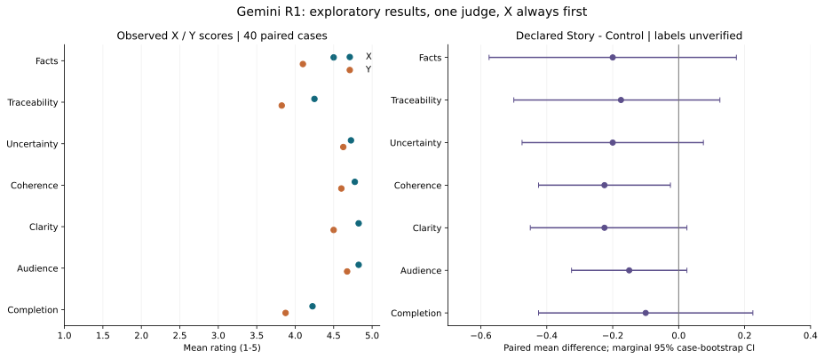
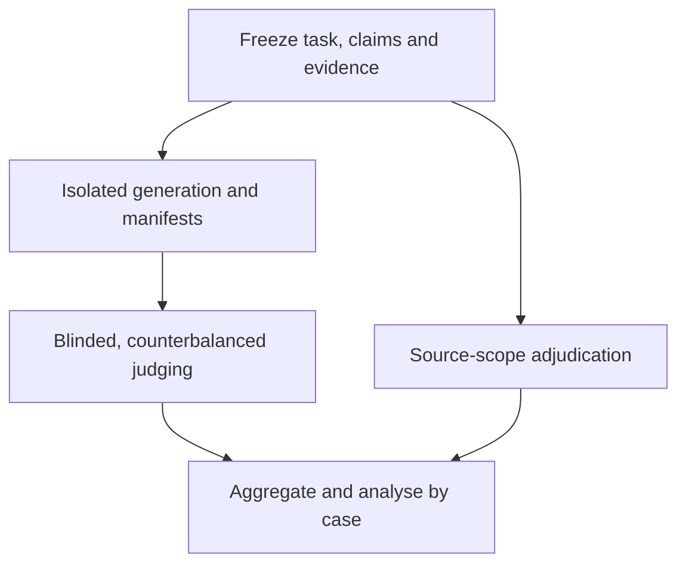

# Gemini R1: 40-case news-writing diagnostic

English · [繁體中文](README.zh-TW.md) · [Research index](../../README.md) · [Parent issue #115](https://github.com/bynanci/storytelling/issues/115)

Use this record to inspect the first model-judged comparison and reproduce its numeric analysis. It is a **model-judged rehearsal using real-news prompts**, dated 2026-11-13 (Asia/Taipei). It supplies no new human observations, product-beta acceptance or release decision.

## Finding and evidence boundary

Across 40 cases, 80 drafts and 560 ratings, the declared skill group averaged **4.361**, versus **4.543** for the declared control. The exploratory equal-weight paired difference is **−0.182 points on a 1–5 scale**, with a case-bootstrap 95% interval **[−0.414, +0.054]** and exploratory sign-flip p=0.1485. This run does not establish improvement, inferiority or equivalence.

The assignments are declared, **not verified generation conditions**. C01–C10 keys survive only in a compacted conversation summary; C11–C40 follow the published batch keys. No per-draft manifest establishes skill activation, isolated contexts or otherwise identical conditions. Do not relabel drafts from their prose style.

## Visual comparison



Left: raw X/Y means. Right: declared skill minus control, with **marginal, unadjusted** 95% case-bootstrap intervals. The figure has no significance stars. Its labels do not certify the missing generation conditions. Bootstrap intervals estimate mean differences; sign-tests below examine the direction among non-tied cases, so their p-values and intervals need not correspond one-to-one.

| Observation | X | Y |
| --- | ---: | ---: |
| Seven-dimension exploratory mean | 4.589 | 4.314 |
| Judge preference, out of 40 | 27 | 10 |
| Original critical-error flags, out of 40 | 5 | 10 |

Three preferences tied. All 40 presentations were **X_then_Y**; text quality and position were not independently manipulated. X won 27/37 decisive comparisons (73.0%; exact 95% CI 55.9%–86.2%; exploratory binomial p=0.00763), which does not by itself establish position bias. Raw flag rates differ by 12.5 percentage points; paired exact McNemar p=0.17969.

Using the declared assignments, the judge preferred skill/control/tie in **15/22/3** cases; original critical flags were **8/7** (exact McNemar p=1.0). Excluding C01–C10 leaves a declared paired difference of **−0.205**, CI **[−0.471, +0.067]**. The remaining assignments still lack generation manifests.

| Dimension | X | Y | Declared skill | Declared control | Skill − control | Marginal 95% CI | Holm sign-test p |
| --- | --- | --- | --- | --- | --- | --- | --- |
| Factual accuracy | 4.500 | 4.100 | 4.200 | 4.400 | -0.200 | [-0.575, +0.175] | 0.898 |
| Source traceability | 4.250 | 3.825 | 3.950 | 4.125 | -0.175 | [-0.500, +0.125] | 0.997 |
| Uncertainty boundary | 4.725 | 4.625 | 4.575 | 4.775 | -0.200 | [-0.475, +0.075] | 0.997 |
| Narrative coherence | 4.775 | 4.600 | 4.575 | 4.800 | -0.225 | [-0.425, -0.025] | 0.445 |
| Clarity | 4.825 | 4.500 | 4.550 | 4.775 | -0.225 | [-0.450, +0.025] | 0.647 |
| Audience fit | 4.825 | 4.675 | 4.675 | 4.825 | -0.150 | [-0.325, +0.025] | 0.898 |
| Task completion | 4.225 | 3.875 | 4.000 | 4.100 | -0.100 | [-0.425, +0.225] | 0.997 |

None of the seven exact sign-tests passes 0.05 after Holm correction. A marginal bootstrap interval excluding zero is not a multiplicity-adjusted confirmation. Ratings hit 5 in 325/560 entries (58.0%); 13 X drafts and five Y drafts scored 5 on all seven dimensions, limiting discrimination.

## Source audit and packet errata

Six targeted disputes had support in the linked original source or paper, despite missing from the shortened packet: C11 brain function/3D/development/species; C12 blood collected before diagnosis; C13 the last 30 seconds; C27 the hospital still operating; C33 exile; C38 52-week mortality. A packet-only task can still flag these as outside its allowed scope. They cannot automatically be counted as real-world fabrications. This selected audit cannot estimate the judge's general false-positive rate, cancel other deductions, or certify all 40 news reports.

Two packet/source mismatches were also found:

- **C13:** the sports ministry names **鄭博隅**; the packet and both drafts used **鄭博宇**. The same original source supports the last-30-seconds detail. [Official source](https://www.sports.gov.tw/News_Content/309/24062).
- **C28:** AP reports additional control of state legislative **chambers**. The packet dropped the newly gained qualification and simplified the unit to whole state legislatures. Preserve the distinction in a versioned correction. [AP syndicated report](https://www.coloradopolitics.com/2026/11/12/democrats-denver-conference/).

The eight annotations, including the six targeted checks and two packet corrections, are in [source_audit_R1.csv](source_audit_R1.csv). They reference live public URLs; archived passages, retrieval timestamps and source-byte hashes were not captured. Original news articles are not redistributed here. Source instructions remain untrusted data.

## What is and is not reproducible

The requester supplied four batches of Gemini ratings. The numeric transcription was independently checked by a second model reviewer: 40 cases, 560 scores, 80 boolean flags and 40 preferences matched. These model reviewers are not human participants.

This package contains **numeric transcriptions**, not a verbatim archive of the full judge JSON, evidence quotations/reasons, all original drafts, complete packets or exact prompts. It can recompute these statistics; it cannot independently replay the original judging or establish treatment integrity. Judge version/settings, skill commit, generation manifests, prespecified primary metric and power plan are unavailable. Raw flags and scores remain unchanged.

Each event/case is the analysis unit. Repeated generation, seven rating dimensions and repeated judge calls are not extra independent cases. Cases were purposefully selected and may share source/topic/judge dependencies; intervals and p-values are exploratory for this set, not population guarantees. The sign-flip test assumes sign exchangeability under its null; actual randomized treatment allocation was not established.

## Reproduce the numeric analysis

Run these commands **from this directory** with Python 3.12. The dependency pins describe the observed analysis environment; setup requires obtaining those packages.

```sh
python3 -m venv .venv
. .venv/bin/activate
python -m pip install -r requirements.txt
python analyze.py
python plot.py
```


`analyze.py` uses seed 20261113, 100,000 case-bootstrap resamples and 200,000 paired sign flips (two-sided, plus-one correction). Preference intervals are exact Clopper–Pearson; critical flags use paired exact McNemar; dimension direction tests use exact sign-tests with Holm correction. The seven-dimension mean is an exploratory equal-weight summary, not a validated psychometric scale. Cross-version reruns need not be byte-identical.

| File | Purpose |
| --- | --- |
| [score_input.py](score_input.py) | Numeric transcription, frozen original flags/preferences and declared keys |
| [ratings_numeric_R1.csv](ratings_numeric_R1.csv), [normalized JSON](ratings_normalized_R1.json) | 80 draft records; original IDs and label provenance retained |
| [case_pairs_R1.csv](case_pairs_R1.csv), [dimension_summary_R1.csv](dimension_summary_R1.csv) | Case and dimension summaries |
| [statistics_R1.json](statistics_R1.json) | Full computed statistics and execution versions |
| [analyze.py](analyze.py), [plot.py](plot.py), [requirements.txt](requirements.txt) | Numeric and visual reproduction |
| [source_audit_R1.csv](source_audit_R1.csv) | Added adjudication; never overwrites R1 |
| [R2 protocol](R2_PROTOCOL.md) | Proposed calibration prompt; changed rules require a separate run |

The input SHA256 in the JSON hashes **score_input.py**, not the missing raw judge JSON. [MANIFEST.sha256](MANIFEST.sha256) identifies this checked-in public package. Reproduction may change environment-version fields; retain the checked-in observation before rerunning. This public audit record includes old allocation keys and scores: do not send the report, scored CSV/JSON or scripts to a blind judge. Build the neutral packet separately under #118.

## Follow-up work

| Task | Priority | Deliverable | Dependencies |
| --- | --- | --- | --- |
| [SK-E01 / #118](https://github.com/bynanci/storytelling/issues/118) | P0 | Generation manifest and blinded allocation | #115 |
| [SK-E02 / #119](https://github.com/bynanci/storytelling/issues/119) | P0 | Evidence modes, required claims and packet errata | #115 |
| [SK-E03 / #120](https://github.com/bynanci/storytelling/issues/120) | P1 | Required-fact and causal-attribution regressions | #118, #119 |
| [SK-E04 / #121](https://github.com/bynanci/storytelling/issues/121) | P1 | Judge calibration and counterbalanced rescoring | #118, #119 |
| [SK-E05 / #122](https://github.com/bynanci/storytelling/issues/122) | P2 | Prospective unseen model-only holdout | #118–#121 |

Proposed next-run flow (not a claim that R1 followed these steps):



For an order-only rerun, keep old drafts, packet and rubric fixed. Calibrated source judgments/new rubrics get a separate run; revised drafts get a new generation and packet version. Do not remove unfavorable cases or relabel outcomes after viewing scores. New effectiveness claims require a prospective plan and unseen cases; forty is not a universal statistical threshold.

This report maps to W1/W4/W5/W6 and ST-R01/ST-R02/ST-R09/ST-R10/ST-R12/ST-R13. It changes no Rust/CLI/schema behavior or existing acceptance. [#54](https://github.com/bynanci/storytelling/issues/54) keeps its disposition; this run does not unblock [#112](https://github.com/bynanci/storytelling/issues/112). AI-assisted analysis and documentation are disclosed; automated checks and model review remain distinct from maintainer or human acceptance. Publication baseline: `48c1ca005c0087a585f2028d59ebb45fcdab5a46`; this is not a recorded R1 tested-skill revision. Original analysis, summaries and charts use the existing repository license; citations confer no rights to copy external articles.
