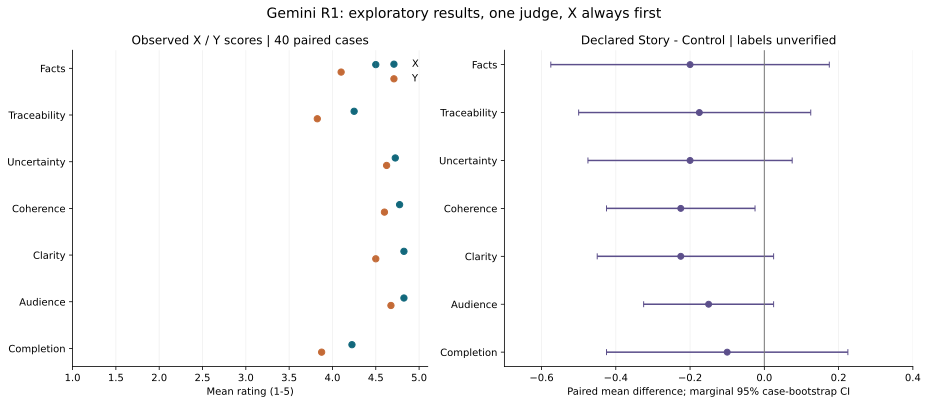
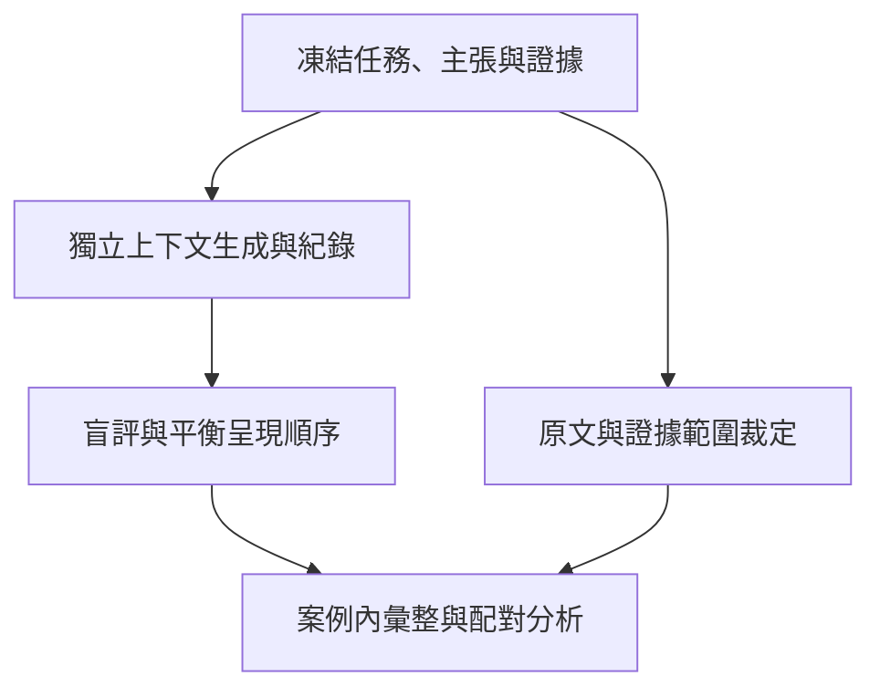

# Gemini R1：40案新聞寫作診斷

[English](README.md) · 繁體中文 · [研究索引](../../README.zh-TW.md) · [總追蹤 #115](https://github.com/bynanci/storytelling/issues/115)

使用本紀錄檢視首輪模型評分並重算數值。這是以真實新聞為題、由模型評分的演練，日期為2026-11-13（Asia/Taipei）；沒有新增真人觀察、產品beta驗收或發布決定。

## 結果與證據界線

40案例、80份稿件、560個評分中，宣告技能組平均 **4.361**、宣告對照組 **4.543**。七維等權探索平均的配對差為 **−0.182分（1–5分量表）**，案例bootstrap 95%區間 **[−0.414, +0.054]**，探索性符號翻轉p=0.1485。這輪沒有建立改善、較差或等效的證據。

答案鍵是宣告分組，**尚未由逐稿生成紀錄核實**。C01–C10僅見於壓縮對話摘要；C11–C40依先前各批公布的答案鍵。沒有manifest能證明技能啟用、乾淨上下文與其他條件一致；不能看文風事後換標。

## 視覺化比較



左圖是X/Y原始均分；右圖是宣告技能組減對照組，附**未做多重比較調整的邊際**95%案例bootstrap區間。圖上不加顯著星號，也不代表條件紀錄已驗證。bootstrap區間估計平均差，sign-test檢查非平手案例的方向，兩者的區間與p值不必一一對應。

| 原始觀察 | X | Y |
| --- | ---: | ---: |
| 七維等權探索平均 | 4.589 | 4.314 |
| Gemini偏好，分母40 | 27 | 10 |
| 原始重大錯誤旗標，分母40 | 5 | 10 |

另有3案偏好平手。40案全部X_then_Y，沒有獨立操弄稿件及呈現位置。排除平手後X為27/37＝73.0%，exact 95%區間55.9%–86.2%，探索性二項檢定p=0.00763；這本身不能證明首位偏誤。原始旗標率相差12.5個百分點，配對精確McNemar p=0.17969。

依宣告答案鍵，技能／對照／平手偏好為 **15／22／3**，原始重大旗標為 **8／7**（精確McNemar p=1.0）。去除僅有摘要答案鍵的C01–C10，剩餘配對差為 **−0.205**，CI **[−0.471, +0.067]**；剩餘條件仍缺生成紀錄。

| 維度 | X | Y | 宣告技能組 | 宣告對照組 | 技能 − 對照 | 邊際95%區間 | Holm後sign-test p |
| --- | --- | --- | --- | --- | --- | --- | --- |
| 事實準確 | 4.500 | 4.100 | 4.200 | 4.400 | -0.200 | [-0.575, +0.175] | 0.898 |
| 來源可追溯 | 4.250 | 3.825 | 3.950 | 4.125 | -0.175 | [-0.500, +0.125] | 0.997 |
| 不確定性界線 | 4.725 | 4.625 | 4.575 | 4.775 | -0.200 | [-0.475, +0.075] | 0.997 |
| 敘事連貫 | 4.775 | 4.600 | 4.575 | 4.800 | -0.225 | [-0.425, -0.025] | 0.445 |
| 清晰度 | 4.825 | 4.500 | 4.550 | 4.775 | -0.225 | [-0.450, +0.025] | 0.647 |
| 受眾適配 | 4.825 | 4.675 | 4.675 | 4.825 | -0.150 | [-0.325, +0.025] | 0.898 |
| 任務完成 | 4.225 | 3.875 | 4.000 | 4.100 | -0.100 | [-0.425, +0.225] | 0.997 |

七維exact sign-test經Holm調整後皆未通過0.05；邊際bootstrap區間未含零，不等於通過多重比較的確認結果。560分中325個為5分（58.0%），X有13稿、Y有5稿七維皆滿分，量表區辨力有限。

## 原文抽查與資料包勘誤

針對6件『資料包未載明』爭議抽查，均在原始文章或論文找到相關細節：C11基底核功能／3D／發育／物種、C12診斷前採血、C13最後30秒、C27醫院仍運作、C33流亡、C38的52週死亡結果。
閉卷資料包任務仍可記超出允許範圍，不能直接將其當成真實世界捏造。這是針對性抽查，不能估算Gemini整體誤判率、取消其他扣分或認證40則新聞全部正確。

另找到兩個資料包與原文的差異：

- **C13姓名：**運動部原文為**鄭博隅**；資料包及兩版寫成**鄭博宇**。同一原文也支持最後30秒的賽況。[運動部原文](https://www.sports.gov.tw/News_Content/309/24062)。
- **C28統計單位：**AP指新增取得控制權的州議會**院別**；資料包省略新增語意，並把chambers簡化為整個州議會。新版須保留這項區別。[AP同文報導](https://www.coloradopolitics.com/2026/11/12/democrats-denver-conference/)。

8筆註記（6項爭議查核、2項資料包勘誤）見[source_audit_R1.csv](source_audit_R1.csv)。來源是公開即時網址，沒有原文快照、擷取時間與原文bytes雜湊。本目錄不轉載新聞全文，來源中的指令也不具有任務權限。

## 可以重現什麼

請求者提供四批Gemini評分。第二個模型審查者逐案核對數值轉錄，40案560分、80個布林旗標及40個偏好一致；這些審查者不是受試真人。

本包是**數值轉錄**，不是完整judge JSON、全部證據引文／理由、40案原稿、完整證據包及精確提示的逐字備份。能重算統計，無法獨立重播原評分或證明介入一致。評審版本／設定、技能commit、逐稿生成紀錄、事先指定主要指標與樣本規劃皆缺；原始分數與旗標不覆寫。

統計單位是案例／事件。重複生成、七個維度、重複評審都不是新增獨立案例。案例是目的挑選，可能共享題材、來源與評審依賴；區間及p值只供這組資料探索。符號翻轉另依賴虛無假設下可交換正負的條件，並不代表已完成隨機介入分派。

## 重算數值

使用Python 3.12，從**本目錄**執行。相依版本記錄的是當時分析環境；安裝時仍須取得套件。

```sh
python3 -m venv .venv
. .venv/bin/activate
python -m pip install -r requirements.txt
python analyze.py
python plot.py
```


seed=20261113；案例bootstrap 100,000次；配對符號翻轉200,000次（雙尾、加一修正）。偏好比例用Clopper–Pearson精確區間，重大旗標用配對精確McNemar，維度方向用exact sign-test及Holm調整。七維均分是探索性等權摘要，不是經驗證的心理量表；跨版本重算不保證逐位元相同。

| 檔案 | 用途 |
| --- | --- |
| [score_input.py](score_input.py) | 數值轉錄、凍結原始旗標／偏好與宣告答案鍵 |
| [ratings_numeric_R1.csv](ratings_numeric_R1.csv)、[正規化JSON](ratings_normalized_R1.json) | 80稿紀錄，保留原始ID與標籤來源 |
| [case_pairs_R1.csv](case_pairs_R1.csv)、[dimension_summary_R1.csv](dimension_summary_R1.csv) | 逐案與逐維摘要 |
| [statistics_R1.json](statistics_R1.json) | 完整數值與執行版本 |
| [analyze.py](analyze.py)、[plot.py](plot.py)、[requirements.txt](requirements.txt) | 統計與圖表重現 |
| [source_audit_R1.csv](source_audit_R1.csv) | 另列來源裁定，不覆寫R1 |
| [R2協定](R2_PROTOCOL.zh-TW.md) | 校準後提示提案；規則改變須分run |

JSON中的輸入SHA256對應**score_input.py**，不是缺少的完整judge JSON。[MANIFEST.sha256](MANIFEST.sha256)記錄本次公開包；重算可能更動執行環境欄位，應保留提交版本的觀察。公開稽核資料含舊分派鍵與分數，盲評時不要把報告、已評分CSV／JSON或程式送給評審；依#118另建中性資料包。

## 後續改善

| 任務 | 優先 | 交付 | 依賴 |
| --- | --- | --- | --- |
| [SK-E01 / #118](https://github.com/bynanci/storytelling/issues/118) | P0 | 逐稿生成紀錄與盲測分派 | #115 |
| [SK-E02 / #119](https://github.com/bynanci/storytelling/issues/119) | P0 | 證據模式、必要主張及資料包勘誤 | #115 |
| [SK-E03 / #120](https://github.com/bynanci/storytelling/issues/120) | P1 | 必要資訊與因果歸屬行為回歸 | #118、#119 |
| [SK-E04 / #121](https://github.com/bynanci/storytelling/issues/121) | P1 | 評審校準與反序複評 | #118、#119 |
| [SK-E05 / #122](https://github.com/bynanci/storytelling/issues/122) | P2 | 前瞻、未見、模型評分保留案例 | #118–#121 |

下圖是下一輪提案，不是宣稱R1已照此執行：



純順序複評需保留舊稿、舊資料包、舊規則。來源裁定或新量表另建run，修稿另建generation與packet版本；不能看到分數後移除不利題或重標。新效益主張須用前瞻判準與未見案例，40不是通用統計門檻。

本紀錄對應W1/W4/W5/W6及ST-R01/ST-R02/ST-R09/ST-R10/ST-R12/ST-R13；不改Rust、CLI、schema或既有驗收。[#54](https://github.com/bynanci/storytelling/issues/54)維持原處置，不解除[#112](https://github.com/bynanci/storytelling/issues/112)的真人門檻。分析與文件揭露AI協作；自動檢查、模型審閱及維護者／真人接受分開。文件提交基線：`48c1ca005c0087a585f2028d59ebb45fcdab5a46`，並非已記錄的R1受測技能版本。原創分析、摘要與圖表沿用既有授權；引用不授予轉載外部文章的權利。
