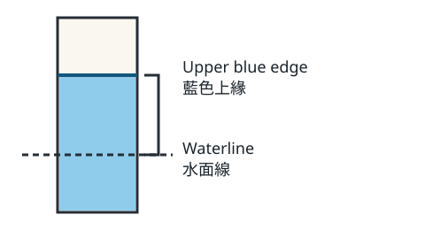

# Where did the blue edge move?

[繁體中文](README.zh-TW.md) · [All cases](../../README.md)

## Audience and author request

Students making their first strip diagram with a pencil and paper.

Write two stand-alone observation cards for the same class, each with the same question. Have students sketch the two heights from the diagram legend and recorded results. Change which instruction comes first. Give the teacher a short demonstration. Keep a possible cause separate from a measurement.

## Source cards

| ID | Material |
| --- | --- |
| S1 | Class log for one strip dipped in blue water. The upper blue edge was 1 cm above the waterline at minute 2 and 4 cm above it at minute 8. The class did not test what caused the change. |
| S2 | Diagram legend for a sketch that students can draw themselves. Draw a horizontal line for the waterline. Mark the upper blue edge above this line, and draw a bracket from the waterline to that edge. Use a separate sketch for each reading. |
| P1 | The teacher may use an opaque paper strip to hide a drawn bracket until a student has found the two ends. The cover is a presentation aid. |

Show the same schematic with both cards. Read values from the class log. The drawing shows the measurement points.

## Three deliverables

[Excerpt A](A.md) · [Excerpt B](B.md)

### Draft C

Draw a waterline, an upper blue edge and the bracket between them. Hide the bracket under a paper strip. Ask one student to point to the waterline and another to the upper blue edge. Lift the strip. The bracket shows a distance. A distance alone cannot tell us why the color moved.

## Change cards for the next editor

Issue one card at a time. Start from fresh copies of A, B and C. Return all three for comparison, including any you kept intact. Note any inference or use condition that needs confirmation.

### R1

Correct the minute-8 entry from 4 cm to 3 cm above the waterline. The minute-2 entry stands.

### R2

The paper cover is unavailable. Replace the cover-and-lift activity with a finger tracing the bracket.

[Facilitator protocol](../../evaluation/README.md) · [Scoring key for this case](../../evaluation/keys.md#classroom-change)
