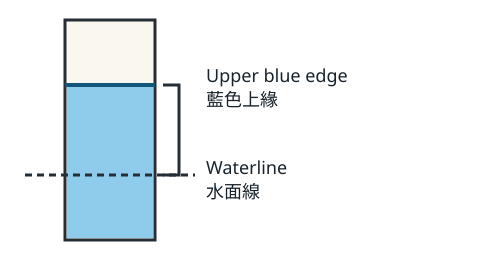

# 藍色邊緣移到哪裡了？

[English](README.md) · [情境總覽](../../README.zh-TW.md)

## 受眾與作者請求

準備用紙筆第一次畫紙條觀察圖的學生。

替同一班學生寫兩張可單獨閱讀的觀察卡，讓他們依圖例和測量值畫出兩個高度。兩張卡問同一個問題，改變學生先得到繪圖指示或測量值。再給老師一段示範說明，把能量到的現象與它的成因分開。

## 素材卡

| ID | 材料 |
| --- | --- |
| S1 | 全班將一條紙條浸在藍色水中。第 2 分鐘，藍色上緣高於水面線 1 公分；第 8 分鐘高出 4 公分。這次沒有做成因實驗。 |
| S2 | 學生可照著畫的圖例：畫一條水平線代表水面，在線上方標出藍色上緣，再用括線連接水面線和上緣。每筆讀值各畫一張小圖。 |
| P1 | 教師示範時可先用不透光的紙片遮住畫好的括線，等學生找出兩端後再掀開。紙片只是教具。 |

兩版都出示同一張示意圖。圖表示量測位置，數值以班級紀錄為準。

## 三份交付稿

[讀本 A](A.zh-TW.md) · [讀本 B](B.zh-TW.md)

### 稿件 C

畫出水面線、藍色上緣和連接兩者的括線，先用紙片遮住括線。請一位同學指出水面線，另一位指出藍色上緣。掀開紙片，看看括線接起哪兩個位置。這條線能標出距離；光看距離，我們還無法解釋顏色移動的原因。

## 給接手者的修改卡

一次只發一張卡。從原始 A、B、C 三稿開始，交回三份可供比對的改後稿，包含原樣交回的版本。請記下待確認的推論或使用條件。

### R1

更正觀察紀錄：第 8 分鐘應為高於水面線 3 公分，原記錄 4 公分有誤。第 2 分鐘的紀錄正確。

### R2

現場沒有不透光的紙片。將遮住再掀開的示範改為用手指沿括線描一次。

[主持人試用流程](../../evaluation/README.zh-TW.md) · [本案評分對照](../../evaluation/keys.zh-TW.md#classroom-change)
