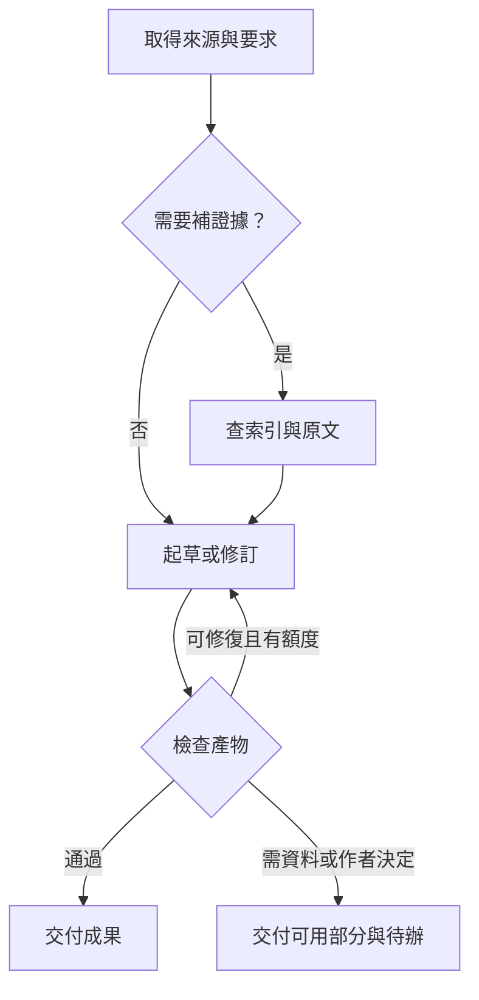

# Storytelling 的工具圖與迴圈

從作者要求的產物往回找必要的步驟。先選最短可交付路徑，遇到剪點、佐證或修訂等需求，再接上對應的工具與檢查。以下列出本 Skill 支援的流程原型；一個任務可組合數個原型。表中的迴圈由使用 Skill 的 Agent 協調。

- [三種圖與執行順序](#三種圖與執行順序)
- [流程目錄](#流程目錄)
- [各種創作情境怎麼走](#各種創作情境怎麼走)
- [執行與效能規則](#執行與效能規則)
- [可重播的驗收情境](#可重播的驗收情境)

## 三種圖與執行順序

| 圖 | 節點與邊 | 如何解讀 |
| --- | --- | --- |
| 敘事關係圖 | 事件、意象、主張、版本之間的關聯 | 「聯想到」可以雙向。「先發生」「先揭露」「必須先交付」分別處理。例如電影先播出結果，之後再揭露原因。 |
| 檢索用知識圖 | Graphify 索引中的實體、關係與來源位置 | 用來找該讀哪一份原文。記錄索引範圍、版本與關係的出處；推斷關係仍須核對。 |
| 工具依賴圖 | 可完成的工作步驟，邊為「前置完成後，後項才有可用輸入」 | 單次執行批次採有向無環圖（DAG）。循環依賴屬衝突。修訂以新輸入版本開始下一次有上限的驗證。 |



圖中的回邊表示新一輪修訂。實際建立工具依賴圖時，用不同工作節點表示不同輪次，例如「文案 v1 → 核對引述 → 文案 v2」。

## 流程目錄

### 決定要交付什麼

| ID／適用時機 | 執行順序與工具 | 驗證、結束與失敗處理 |
| --- | --- | --- |
| L01 直接起草。單一輸出且材料足夠 | 從對話取得來源、受眾與篇幅 → 寫出請求的作品 → 對照原話。通常零工具呼叫。 | 檢查形式、作者要求及重要細節。條件符合即交付。未提供的事實保留空白，虛構設定只進創作版本。 |
| L02 轉換用途或消除歧義。受眾、敘事角度或用途不明 | 先使用已給條件。可逆的選擇採簡短假設並附可用稿；只有會改變核心輸出而無法合理推定的資訊才詢問。 | 說清採用的受眾或用途。作者給新答案時，從受影響的部分接續。 |
| L03 發散。需要構圖方向、故事點子或互斥選項 | 依不同焦點、視角、場景或核心假設展開分支；按主要差異分組，合併重複選項。一般以對話就能完成。 | 每一版須指出一個可觀察差異。未指定數量時交付最多三個有意義方向；作者指定數量依要求。列出未決問題即可停在發散。 |
| L04 收斂與作者選擇。請求比較、選一版或保留並行版本 | 按作者的取捨條件逐一評估候選，建議符合條件的一版並保留重要代價。要求保留多案時，分別給予版本名稱。 | 建議與作者已採納的決定分別記錄。只有下一步確實依賴作者選項時才等待。 |
| L05 多產物分支與匯合。同一材料要做口述、海報、文案等 | 共用一份來源表，分別生成具名產物，再比對共用事實、版本專屬細節及缺件。相依內容等前置完成；獨立的唯讀檢索可並行。 | 各產物個別驗收。一個分支缺資料時，仍交付已完成分支並具體指明缺件。 |

### 取證、排程與交接

| ID／適用時機 | 執行順序與工具 | 驗證、結束與失敗處理 |
| --- | --- | --- |
| L06 定位並讀回來源。一項主張涉及多份文件或實體關係 | 有明確單一檔案先直接讀取。已有適用的 Graphify 索引時，選擇最小範圍的查詢／關係路徑 → 打開候選原始段落 → 保存位置與版本。操作見[工具指引](graphify-tools.md)。 | 有可核對且範圍適當的原文就停止。沒有索引或工具時，改讀授權的原始材料，可用主機既有的檔案搜尋；只有索引線索的主張保留待查。 |
| L07 證據空缺、矛盾或過期。文案、紀實敘事出現互斥說法 | 先列主張、日期、樣本、單位與來源。檢查是否在談不同群體或不同版本，再找一份最有機會解決問題的原始資料。 | 引用以原文實際支持的範圍為限。仍矛盾時列出兩說或改用較窄的可支持措辭。每個未決問題預設最多三個不同的檢索請求，達限列出缺口。 |
| L08 相依工作排序與循環診斷。多步工具或有硬性順序 | 將明確的作業先後放入 DAG。複雜時可使用套件內的[唯讀規劃器](../scripts/graph_plan.py)排程。只有就緒工作才可呼叫工具。 | 非法參照、硬先後循環先診斷；保留問題分支及可獨立交付內容。自由聯想邊、事件揭露順序、審稿回饋各有自身語意，請勿整張照搬成前置依賴。 |
| L09 影片計畫到機器驗證。有受支援的結構化輸入，作者要求驗證、選鏡或 OTIO | 確認本機能力與輸入類型，再選擇 `validate`、`plan-story` 或以提案、快照及 context 呼叫 `prepare-story-review`／`export-story-otio`。若有舊 bundle 則可 `check-story-review`。[CLI 流程](video-cli.md) | 核對退出狀態、實際輸出和驗證範圍；過期的審閱需重新產生與檢視。缺剪點、識別或 CLI 時交付文字分鏡並列缺項。正式匯出檔或宿主作業另依實際授權。 |

### 品質回饋、失敗恢復與停止

| ID／適用時機 | 執行順序與工具 | 驗證、結束與失敗處理 |
| --- | --- | --- |
| L10 獨立核對與有界修稿。多主張、多輸出或作者要求審稿 | 先各自核對來源事實及格式／節奏，再合併具體缺陷。只修有缺陷的段落，重驗其直接依賴。可由同一 Agent 分開核對；獨立 reviewer 有實際參與才記錄其意見。 | 第一輪通過即停止。每份產物每次任務預設最多兩輪修復；相同診斷和輸入重現且沒有進展時提早停止。留下最佳可用版與仍待修正之處。 |
| L11 來源修訂與局部重算。作者改一個細節、版本或受眾 | 保留新舊 revision，沿「來源 → 引用此來源的工作 → 其下游產物」走訪，用 visited 避免重複。更新引用與失效結果，重新執行必要工作。 | 核對受影響與未受影響兩類，保留舊決定。只有已確認其他前置產物仍有效時才使用局部執行；依賴紀錄缺失時重驗相關整個產物。 |
| L12 唯讀暫時失敗。逾時、流量限制、查詢服務暫時無回應 | 先辨別錯誤類型；唯讀且暫時性的失敗可依服務提示退避後重試一次。參數錯誤先修正輸入，權限、能力或缺資料則改用可用的合法替代來源。 | 同一輸入的永久錯誤直接返回診斷；若重試也失敗，保留已取得材料並標示查核範圍。重試不可擴大索引或資料傳送範圍。 |
| L13 有副作用或結果不明。作者要求寫出檔案、建立索引或交接外部工具 | 先辨識範圍、目標、既有授權與工具能力；轉換損失或有衝突的覆寫須依作者選擇。逾時或回應遺失時先讀回目標／作業紀錄，比對該次操作的識別與內容。 | 已成功則沿用結果。只有確認尚未生效且可安全重送時才重送；無法區分已生效或未生效就停止該操作，記為結果不明，交付可用草案與人工核對點。 |
| L14 交付與再次進入。分支已完成、耗盡預算、或卡在作者取捨 | 彙整所需產物、來源缺口及實際工具結果。小任務直接給成品；複雜任務附短紀錄，指出哪些機器檢查真的跑過、哪些仍需人判讀。 | 完成即停止。有新來源、新選擇或明確追加的範圍，從相應 L02、L05 或 L11 接續。保留原版本以利比較。 |

## 各種創作情境怎麼走

| 作者要做的事 | 常用路徑 | 本次可判斷的完成條件 |
| --- | --- | --- |
| 日常口述 | L01 → L14；作者改事實再接 L11 | 好念、符合受眾與長度，經歷與創作提議可辨別。 |
| 編劇或倒敘 | L03 → L04 → L08 → L10 → L14 | 場景目標、轉折、事件與揭露順序均說得通；虛構前提在各場景一致。 |
| 單幅插畫構思 | L01 或 L03 → L04（依需要）→ L14 | 每案指出視覺焦點與空間配置；畫面專屬新增物件只影響該案。產物是構圖 brief。 |
| 商業文案 | L06 → L07 → L01 → L10 → L14；來源已給且足夠可直接 L01 | 主張對得回樣本、期間與數據；未證實措辭或標語單獨處理。 |
| Brainstorming | L02 → L03 → L14；要求選案時加 L04 | 有可比較的方向、衝突與未解問題；允許先保留分支。 |
| 聲音日誌、Podcast 或有聲展件 | L01 → L10 → L14；有圖文與音檔共用來源時加 L05 | 口播與停頓能執行，音源、擬音及估時能區分。若只取得逐字稿，保留音色、聲源及同步關係待查。 |
| 流派 A/B 對照 | L03 → L04 → L10 → L14 | 固定來源與交付條件，再比較視角、揭露順序、聲音層次或版面主次。作者可指出每案真正不同的選擇。 |
| 文字分鏡或可重播粗剪 | L01 或 L08 → L09 → L14 | 僅有文字時交分鏡構想；有可用 CLI 與正式輸入時交命令對應的實際產物與限制。 |
| 混合用途與中途轉向 | L05 → L10 → L14；換受眾用 L02，改來源用 L11 | 共享來源一致，每版有名稱，改口述不會誤改插畫，已完成分支可獨立交付。 |

## 執行與效能規則

- 一句原始觀察只要一段回答時，直接走 L01。一旦需要多步排程才建工具圖。檢索先指定資料範圍，逐步擴張至足以定案的位置。每個不同問題的預設查詢上限是三次；用同義字重複同一請求仍消耗額度。明確要求更廣的研究時，先依新範圍配置預算。
- 將獨立唯讀工作從就緒佇列取出，預設同時最多兩個，尊重宿主與使用者限制。需要上游輸出、寫入同一目的地或共享有副作用的資源時，依序執行。沒有並行能力時以相同依賴順序串行即可。
- 在同一任務中重用已完成的相同唯讀請求。比對工具與 profile 版本、操作、正規化輸入、來源與索引 revision、快照及產物識別、審閱 context、儲存庫範圍與可見權限。來源或權限無法確認時重新核對；逾時、失敗及未知結果不當成成功快取。尊重原始宣告順序等具有語意的欄位。
- `V` 為工作節點，`E` 為硬性前置邊。用鄰接表、入度表與 Kahn 佇列，完整規劃的時間與空間各為 O(V+E)。若已持有可信的最新依賴索引，從變更節點走訪下游的額外成本為 O(Vᵣ+Eᵣ)。獨立呼叫套件規劃器仍要讀取並驗證完整圖，整次成本為 O(V+E)。取最少無權重邊數的路徑時才需 BFS；這個距離不衡量敘事品質或證據強度。平時毋須兩兩比對所有來源與版本。
- 數量和輪次是單次使用的預設成本界限。達到上限就交付能用的結果及剩餘差距。作者明確指定較多提案或更深審查時，依該範圍重新配置；相同輸入與診斷持續重現時，回報未解點。

同一次任務使用一份工作紀錄。將未解問題綁定到主張及來源版本，讓各分支共用查詢與額度；更換問法、工具或 reviewer 均沿用紀錄。起草前列明有限的交付物和硬性依賴。每次迴圈必須至少完成一項工作、消耗一次有限嘗試，或將一個分支標記待資料／決策。若整輪三者皆未發生，立刻交付目前結果並說明卡點。這可以避免檢索、審稿與修訂三個流程彼此重新啟動。若全圖檢查回報硬性循環，保留循環見證；只有能獨立確認與問題分支沒有相依的交付物，才能拆成另一張有效圖執行。

以下為 Agent 的行為虛擬碼。排程 helper 只計算工作順序與影響範圍，工具執行、重試、作者決策與交付仍由呼叫端協調。

```text
若材料足夠、只需單一文字產物：
    起草 → 比對原話及要求 → 交付
否則：
    列出產物、來源版本、可用工具與硬性前置
    檢查依賴有效；有硬性循環就定位衝突
    重用仍有效的結果，取得可執行工作
    當有就緒工作：
        就緒且獨立的讀取以有限並行執行
        寫入按授權與資源依序處理
        逐項檢查輸入版本、退出狀態與預期產物
        通過 → 保存結果，解除相依工作的前置
        暫時讀取失敗 → 依 L12 重試
        寫入結果不明 → 依 L13 讀回核對
        有具體可修問題且仍有額度 → 只修受影響項目
        受阻或無進展 → 標示該分支，繼續獨立工作
    交付已完成產物、實際證據與未解處
```

### 規劃器的最小例子

從已安裝的 Skill 資料夾執行 `python3 scripts/graph_plan.py`，將以下 JSON 送至標準輸入。省略 `changed` 會規劃全部工作；傳空陣列表示沒有要重新執行的節點。

```json
{"nodes":["source","concept","speech","poster"],"edges":[["source","speech"],["source","poster"],["concept","poster"]],"changed":["concept"]}
```

在其他前置結果已確認有效的情況下，`order` 為 `["concept","poster"]`，`affected` 為相同兩個 ID。`order` 依 FIFO Kahn 輸出：起始就緒節點依宣告順序，後續就緒順序受邊的宣告順序影響。`affected` 按節點宣告順序列出。即使只選一個分支或沒有變更，仍先驗證全圖。規劃器接受最多 1 MiB、4,096 個節點及 16,384 條邊。遇到超出限制的大工作圖，先依獨立交付物切分，對跨組依賴保留明確輸入與驗收邊界。

### 核對觀察到的執行順序

有審查需求時，從 Skill 資料夾執行 `python3 scripts/check_trace.py` 並傳入軌跡 JSON。保留實際命令、輸出或來源段落作為外部佐證。工具只會核對事件次序和宣告的一致性，`pass` 的驗證依據由記錄者提供。

```json
{"nodes":["read","draft","check"],"edges":[["read","draft"],["draft","check"]],"events":[["start","read"],["pass","read"],["start","draft"],["pass","draft"],["start","check"],["pass","check"]],"outcome":"complete"}
```

每個 ID 在單份軌跡中只開始一次。所有硬前置皆已 `pass` 才可 `start`；互不相依的工作可先後交錯開始、完成。失敗記為 `fail`，副作用結果仍待核對記為 `unknown`，只完成一部分時用 `partial`。重試或修復要以另一份軌跡記錄新嘗試，或展開新的工作分支，只將真正成功且提供資料的步驟列為硬前置。前次失敗可記在診斷／分支選擇依據中，避免把它改寫為成功以便繼續執行。

在上例中若先送出 `["start","draft"]`，工具會回報 `prerequisite_unverified`。若一項寫入成為 `unknown`，可交付如實記錄的 `partial`；此時退出 0 代表紀錄一致，業務成果仍屬部分完成。

### 排程器實測

在 CPython 3.12.14 的同一個行程重用解析好的 JSON。每個節點連往接下來至多四個節點，只變更倒數第二個節點。每組執行十次，取五組的每次平均耗時中位數。這個量測涵蓋輸入結構檢查、全圖拓撲排序與影響範圍計算；不含 Python 啟動、JSON 解碼、外部工具、模型或網路。

| 節點 | 前置邊 | 需要重新執行的節點 | 本次排程耗時 |
| ---: | ---: | ---: | ---: |
| 256 | 1,014 | 2 | 0.63 ms |
| 1,024 | 4,086 | 2 | 3.06 ms |
| 4,096 | 16,374 | 2 | 10.78 ms |

獨立呼叫的總成本為預期 O(B+V+E)，B 是輸入位元組數。對於每次都要檢查整份新圖的介面，讀取所有節點和邊本身就是線性工作。這項結果說明本機排程成本；真正的跨文件任務還要計入讀原文、Graphify 查詢、模型起草與修訂耗時。

## 可重播的驗收情境

下列是驗收輸入與預期行為。將工具實際輸出另外記錄。

1. **口述＋海報。** 輸入「志工把三張桌子搬到窗旁。做一段分享和兩款海報，貓只放 B」。走 L05，在同一份觀察上產生三份輸出。作者改成四張桌子，走 L11 更新所有引用該數量的輸出。作者只換 B 的貓色，A 與口述維持原版。這個案例無需 Graphify。
2. **查文案依據。** 給定兩份試行紀錄：一份寫同一組整理時間從 10 到 8 分鐘，另一份是不同團隊。L06 直讀已指定檔案；另有跨資料夾關係待釐清時才查合適索引，回讀原文。L07 確認族群與指標後，可寫「該試行組平均耗時下降 20%」。宣稱「每個團隊效率都增加 20%」仍待證據。若兩份同範圍資料衝突，保留差異並完成可支持版本。
3. **先出純文字，後做剪輯交接。** 只有片段描述時先 L01 交文字分鏡。補上候選視窗、快照與 context 並要求審閱檔後，走 L08 → L09；只有實際呼叫成功才能報告產生 OTIO。剪點改變後 L11 重驗舊 bundle；缺少執行檔就交文字稿並指出這次尚未取得機器結果。
4. **檢索服務短暫逾時。** 兩個獨立分支中，一項原文可直接讀，另一項 Graphify 查詢逾時。走 L12 確認是讀取再重試一次；仍失敗就讀授權範圍內的已知來源或留下缺口。另一分支正常交付，並記下這次的查核範圍。
5. **交接可能重複執行。** 如果未來有明確授權的外部交接工具，逾時後可能已將同一提案套用到宿主。走 L13 以操作識別及目標讀回狀態，確認已套用就沿用；讀回仍有歧義時，標明結果不明並停止重送。目前的本機文字與 OTIO 產物可以單獨交付。
