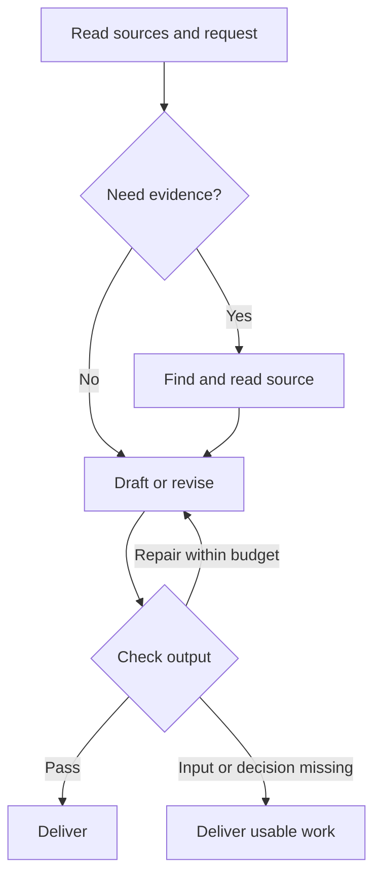

# Workflow graphs and revision loops

<a name="storytelling-的工具圖與迴圈"></a>

[繁體中文](graph-loops.zh-TW.md)

Start from the requested result. Choose the shortest route that can produce and check it. Combine the routes below when a job needs several outputs. The host agent coordinates the tools.

<a name="三種圖與執行順序"></a>

## Graphs and execution order

| Graph | Nodes and edges | Meaning |
| --- | --- | --- |
| Narrative | Events, images, claims and variants | An association can run both ways. Event order, reveal order and delivery order serve different purposes. |
| Retrieval | Entities, relationships and locations in a Graphify index | A result points to material to inspect. Record the index scope, revision and relationship source. |
| Workflow | Tasks and hard prerequisites | A prerequisite produces input for the next task. A cycle blocks that plan. Start a bounded revision with a new input version. |



The return edge represents another revision. Give each pass a separate workflow node, such as draft v1, citation check and draft v2.

<a name="流程目錄"></a>
<a name="決定要交付什麼"></a>
<a name="取證排程與交接"></a>
<a name="品質回饋失敗恢復與停止"></a>

## Route catalog

| Route | When to use it | Actions and pass condition |
| --- | --- | --- |
| L01 Direct draft | One output with sufficient material | Draft for the requested audience and length. Check facts against the source. This route usually needs no tool calls. Leave unknown facts open. Put inventions only in their intended variants. |
| L02 Resolve the brief | Purpose, viewpoint or audience is unclear | Use the available constraints. State a reversible assumption when it permits a usable draft. Ask only when a missing answer changes the main output and cannot reasonably be inferred. Resume the affected part after a correction. |
| L03 Explore options | The author wants different ideas or compositions | Vary a viewpoint, scene, focus or premise. Group options by their main difference. Combine duplicates. Show one observable distinction per option. Offer up to three directions by default or the author's requested number. Keep unresolved branches open. |
| L04 Select or retain | The author asks for a comparison or selection | Compare candidates against the author's criteria. Name the trade-off. Give retained variants separate names. Record the recommendation separately from the author's decision. Wait only if the next step requires a choice. |
| L05 Split outputs | One source supports several forms | Share the source record. Draft each named output. Check common facts, variant-specific details and missing inputs. Parallel reads must be independent. Check each deliverable separately. Deliver unaffected branches when another lacks input. |
| L06 Locate evidence | A claim links sources or entities | Read a known file directly. For a suitable Graphify index, use a narrow lookup. Open the original passage and record its location and revision. If the index is unavailable, search the authorized originals. An index lead alone leaves the claim unresolved. [Graphify guide](graphify-tools.md) |
| L07 Resolve evidence gaps | Records disagree, lack evidence or use an older revision | List the claim, date, sample, unit and source. Check whether the populations or versions differ. Read the primary source most likely to resolve the question. If accounts still conflict, preserve both or narrow the claim. Stop after three distinct lookups per question by default. |
| L08 Schedule tasks | Several tool calls share hard prerequisites | Put only hard dependencies in a DAG. Use the [planner](../scripts/graph_plan.py) when appropriate. Start only ready tasks. Report invalid references or a cycle witness. Deliver independent work when its prerequisites can be verified separately. |
| L09 Check video data | A request includes supported structured input and asks for shot selection or OTIO | Use the matching [CLI command](video-cli.md). Check the exit status, output and scope. Refresh a stale review before use. If the CLI, cuts or IDs are missing, give a written shot plan and list the gaps. Host actions require their own authorization. |
| L10 Review and repair | Several claims, outputs or an explicit review | Check facts, format and pacing separately. Combine concrete defects. Repair affected passages and check their dependents. Record an independent reviewer only if one participated. Stop when all checks pass or after two repairs. Stop earlier when the same input and diagnostic recur without progress. |
| L11 Recheck a revision | Source, audience or a variant changes | Keep the old and new revisions. Follow source references to affected tasks and their descendants. Mark each visited node once. Check affected and unaffected outputs. Preserve prior decisions. Where dependency records are incomplete, check the enclosing deliverable. |
| L12 Retry a read | A read times out, hits a rate limit or encounters a temporary outage | Classify the failure. For a transient read, follow the service delay and retry once. Edit invalid arguments before another attempt. For missing access or input, use an authorized alternative. Record persistent failures and coverage. Keep the original access scope. |
| L13 Resolve an uncertain write | A file, index or host handoff may have changed | Check scope, target, capability and authorization. Follow the author's choice for overwrites and conversion losses. After a timeout, read the destination or operation record. Match the operation ID and content. Reuse a result after readback shows success. Resend only when the action did not occur and retry is safe. Stop on ambiguity. |
| L14 Deliver or resume | Work passes, budgets expire, or a decision is missing | Give the usable outputs. Name remaining evidence gaps and observed tool results. Keep the old version. New evidence, a new choice or an explicit scope change can resume L02, L05 or L11. |

<a name="各種創作情境怎麼走"></a>

## Routes by use

| Author's request | Usual route | Check |
| --- | --- | --- |
| Everyday account | L01 → L14. Use L11 for a correction. | The text reads aloud at the requested length. The audience can distinguish experience from invention. |
| Screenplay or flashback | L03 → L04 → L08 → L10 → L14 | The objective, turn, event order and reveal order agree with the premise. |
| Illustration | L01 or L03, optionally L04, then L14 | Each brief has a focal point and layout. A proposed prop stays in its named version. |
| Commercial copy | L06 → L07 → L01 → L10 → L14. Start at L01 when sources suffice. | Each claim matches its sample, period and measure. Flag unsupported slogans. |
| Brainstorm | L02 → L03 → L14. Add L04 for a decision. | Alternatives, conflicts and open questions remain visible. |
| Podcast or sound exhibit | L01 → L10 → L14. Add L05 for shared media. | Show voice, pauses, source, Foley and estimates. A transcript alone cannot establish timbre, cause or synchronization. |
| Two treatments | L03 → L04 → L10 → L14 | Use the same source and delivery requirements. Compare viewpoint, reveal, sound layers or visual hierarchy. |
| Storyboard or rough cut | L01 or L08 → L09 → L14 | Text alone supports a shot plan. Supported structured input and a working CLI can produce the requested machine output. |
| Mixed formats or new direction | L05 → L10 → L14. Use L02 for a new audience and L11 for a source revision. | Keep shared facts consistent. Deliver finished branches independently. |

<a name="執行與效能規則"></a>

## Scheduling and cost

- Draft directly for one observation and one response. Create a workflow graph only when scheduling helps. Expand a search only enough to resolve the question.
- One question has three distinct lookups by default. Rewording the same request still uses that budget. A wider research request can define a new scope and budget.
- Take at most two independent reads from the ready queue at once by default. Respect lower host or user limits. Serialize dependencies, writes to one target and actions on shared resources with side effects.
- Cache only successful, identical reads within the request. Match the tool version, profile, operation, normalized input, source and index revisions. Also match snapshot and artifact IDs, review context, repository scope and permissions. Keep meaningful declaration order. Recheck uncertain source versions or permissions.
- Use adjacency lists, indegrees and Kahn's queue. Scheduling takes O(V+E) time and space for V tasks and E hard edges. With a trusted current dependency index, a downstream traversal costs O(Vᵣ+Eᵣ) for the reachable part. A standalone planner still checks the entire graph. Use breadth-first search only for the shortest unweighted path. Path length measures neither story quality nor evidence strength.

Use one record per request. Tie unresolved questions to their claims and source revisions. Branches share lookup and repair budgets. Changing route, reviewer or wording preserves the budget. Declare finite outputs and hard dependencies before drafting.

Each pass must complete work, consume a bounded attempt or mark a branch as waiting for input. Stop if an entire pass does none of these. Report the best available result and the remaining gap. For a hard cycle, keep the cycle witness. Run another graph only for outputs you can prove independent of the blocked branch.

```text
if one text output has sufficient material:
    draft, check the source, deliver
else:
    list outputs, source revisions, tools and hard prerequisites
    validate the graph and identify any cycle
    reuse eligible verified results
    while work is ready:
        run independent reads within the limit
        serialize authorized writes to each resource
        check input revisions, exit status and output
        on pass: save the result and release dependent work
        on temporary read failure: follow L12
        on uncertain write: follow L13
        on a repairable defect: repair within the budget
        on a blocked branch: record the gap and continue independent work
    deliver verified outputs, evidence and gaps
```

The caller executes tools and decides on retries. The scheduling helper computes order and impact only.

<a name="規劃器的最小例子"></a>

## Replay a dependency plan

From the installed skill folder, send this JSON to `python3 scripts/graph_plan.py`.

```json
{"nodes":["source","concept","speech","poster"],"edges":[["source","speech"],["source","poster"],["concept","poster"]],"changed":["concept"]}
```

With valid prior results, both `order` and `affected` contain `["concept","poster"]`. Without `changed`, the planner schedules all work. An empty array selects no work. Both paths check the full graph.

The FIFO queue first uses node declaration order. Later insertions follow edge declaration order. The `affected` list follows node declaration order. The limits are 1 MiB, 4,096 nodes and 16,384 edges. For a larger job, split independent deliveries. Specify the inputs and checks for dependencies between groups.

<a name="核對觀察到的執行順序"></a>

## Replay a trace

Send this JSON to `python3 scripts/check_trace.py` from the skill folder. Retain actual commands, results or source passages. A recorded pass requires evidence from the caller.

```json
{"nodes":["read","draft","check"],"edges":[["read","draft"],["draft","check"]],"events":[["start","read"],["pass","read"],["start","draft"],["pass","draft"],["start","check"],["pass","check"]],"outcome":"complete"}
```

Each node can start once per trace. Every hard prerequisite must pass before its dependent starts. Independent tasks can overlap. Record a failure as `fail`, an unresolved side effect as `unknown`, and an incomplete outcome as `partial`. Record another attempt in a new trace or an explicit new branch. Keep the previous failure in the diagnostic record.

Starting `draft` first returns `prerequisite_unverified`. A truthful partial trace with an unknown write can exit 0. That status verifies the consistency of the trace.

<a name="排程器實測"></a>

## Recorded planner measurement

The test reused parsed JSON in one CPython 3.12.14 process. Each node connected to the next four nodes where available. Only the penultimate node changed. The reported time is the median of five batch means, with ten runs per batch.

| Nodes | Hard edges | Nodes to rerun | Scheduling time |
| ---: | ---: | ---: | ---: |
| 256 | 1,014 | 2 | 0.63 ms |
| 1,024 | 4,086 | 2 | 3.06 ms |
| 4,096 | 16,374 | 2 | 10.78 ms |

Times cover structural validation, topological sorting and impact calculation. They exclude startup, JSON decoding, external tools, models and network calls. A standalone call costs O(B+V+E), where B is the input size in bytes.

<a name="可重播的驗收情境"></a>

## Cases to replay

1. **Speech and posters.** Volunteers move three tables to the window. A cat belongs only in poster B. Run L05. After a correction to four tables, use L11 on every draft that mentions the number. Changing the cat's color affects only B. No index is necessary.
2. **Evidence for copy.** One pilot group's average time fell from ten minutes to eight. A second record concerns a different team. Read both originals with L06. Use an index only for unresolved relationships. L07 supports a 20% reduction for the first group. It cannot support the same result for every team. Preserve any unresolved conflict.
3. **Storyboard to edit.** With descriptions alone, L01 produces a written storyboard. With candidate windows, a matching snapshot and review context, L08 and L09 can produce an OTIO handoff. Report the artifact only after successful execution. When a cut changes, use L11 to check the previous bundle. Without the CLI, identify the missing result.
4. **Temporary lookup failure.** One branch can read its source while another lookup times out. L12 allows one retry for the read. Use an authorized original or declare the gap if the retry fails. Deliver the successful branch.
5. **Possible duplicate handoff.** A future authorized host call could apply a proposal before its response times out. Use L13 to check the operation ID and actual destination. Reuse a result that matches the destination. Stop if the result remains ambiguous. Deliver any usable local text or OTIO artifact separately.
